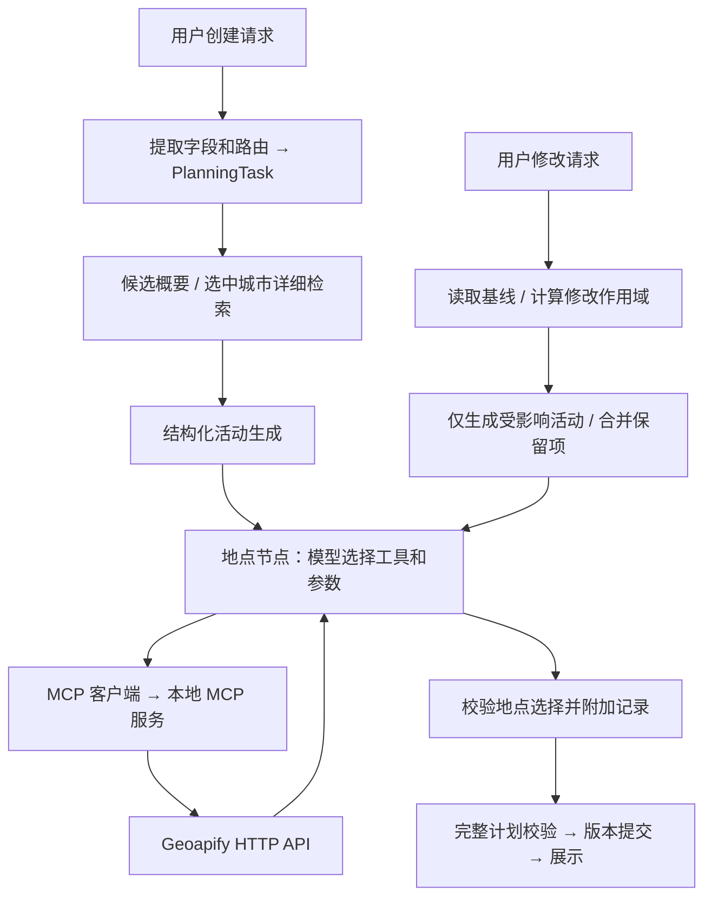

# 从一段对话理解 RAG、模型工具调用与 MCP

更新日期：2026-10-16。原始轨迹和评测报告保留在本地，不向仓库提交完整会话、
供应商响应或密钥。本说明对应当前统一规划流程。

## 先理解已成功的单节点实验

```bash
python -m scripts.test_places --resolve --city Paris --query 'Louvre Museum'
```

该次真实运行为 3 轮模型、2 次工具调用、1 个成功解析活动，约 24.1 秒：

| 顺序 | 动作 | 代码 |
|---|---|---|
| 1 | 脚本创建带稳定 ID 的测试活动 | `scripts/test_places.py` |
| 2 | 节点发现 MCP 工具，向模型提供 schema | `place_resolution.py`、`places_mcp_client.py` |
| 3 | 第一轮模型选择 `search_places(city=Paris, query=Louvre Museum, limit=5)` | `llm.generate_tool_turn` |
| 4 | 程序校验后，经 MCP 查询 Geoapify | client → server → provider |
| 5 | 第二轮模型使用搜索结果 ID 请求 `get_place_details` | `llm.generate_tool_turn` |
| 6 | 程序查询并返回真实地点记录 | `places_mcp_client.py`、`place_provider.py` |
| 7 | 第三轮模型返回活动与地点的选择关系 | `ResolutionDraft` |
| 8 | 程序校验选择，把工具记录中的坐标附加到活动 | `place_resolution.py` |

实际坐标是 `48.8611473, 2.3380277`，返回名称为 `Musée du Louvre`。搜索 ID 与
详情规范 ID 可以不同，通过 `requested_place_id` 关联，而非要求字符串完全相等。

这次轨迹有 7 个嵌套 span：2 个流程包装 + 3 个模型调用 + 2 个 MCP 调用。
它不表示 7 次工具调用。单节点实验没有运行 RAG、完整计划校验或版本提交。

## 完整两轮对话

输入保存在 `evals/scenarios/mcp_walkthrough.json`：

1. 创建巴黎一日行程：上午卢浮宫，下午埃菲尔铁塔，分别作为活动。
2. 将下午替换为奥赛博物馆，保留上午活动。

配置模型与 Geoapify 密钥，并启用地点节点后执行（会消耗真实服务额度）：

```bash
python -m scripts.eval_scenarios --mode live --suite evals/scenarios/mcp_walkthrough.json
```

每次结果可能不同；验收看约束、来源、活动数量和保留记录，不依赖固定措辞。
返回目录中包含 `report.json`、`report.md` 与每轮的 `trajectories/`。

2026-10-16 的两轮真实验收结果：

| 指标 | 创建 | 局部修改 |
|---|---|---|
| 最终活动 | 上午卢浮宫、下午埃菲尔铁塔 | 上午卢浮宫、下午奥赛博物馆 |
| 计划版本 | 1 | 2，plan ID 不变 |
| 模型调用总数 | 5 | 5 |
| 其中地点节点模型轮数 | 3 | 3 |
| 地点 MCP 调用 | 4 | 3 |
| 地点解析范围 | 2 个新活动 | 仅 1 个替换活动 |
| 解析结果 | 2/2 | 1/1，上午记录完全保留 |

两轮均没有 fallback，含 API 与本地处理的耗时约 32 秒和 28 秒。两轮记录的模型
费用估算合计约 $0.0209，不包含 Geoapify 额度成本。这是单次测量，不是性能承诺。
内部 span 总数包含包装层；业务轮次、模型调用、RAG 检索与 MCP 次数要分别统计。



路由和行程生成主要使用文本/结构化输出接口；地点节点使用原生 function calling。
RAG 目前由调度器调用本地检索工具，并未自动变成模型自主选择的 MCP 工具。
MCP 客户端和服务端都是我们的进程；Geoapify 是服务端调用的 HTTP 数据源。

## 按这个顺序读代码

下列后端模块均位于 `backend/app/`：

| 顺序 | 模块 | 要理解的问题 |
|---|---|---|
| 1 | `chat.py`、`strategy.py`、`task_builder.py` | 输入怎样变成创建/修改任务，缺字段怎样澄清？ |
| 2 | `planning_models.py`、`models.py` | 活动、地点、证据、任务分别保存什么？ |
| 3 | `unified_planner.py` | 为什么候选做概要，选中城市才生成每日活动？ |
| 4 | `destination_analysis.py`、`knowledge.py` | 检索了什么，证据怎样传给下游？ |
| 5 | `plan_builder.py` | 哪些内容由模型生成，哪些数值只能来自工具？ |
| 6 | `place_resolution.py` | 模型怎样循环，怎样限制范围和次数？ |
| 7 | `llm.py` | 怎样适配两家模型 API、保留 call ID 和返回工具结果？ |
| 8 | `places_mcp_client.py` | 怎样启动会话、发现并调用工具？ |
| 9 | `places_mcp_server.py`、`place_provider.py` | 工具怎样映射为真实 HTTP 查询？ |
| 10 | `revision.py`、`plan_validation.py`、`plan_store.py` | 什么能改、什么保留、何时提交？ |
| 11 | `trajectory.py`、`execution.py` | 轨迹记录什么，预算在哪里生效？ |

## 用轨迹回答问题

1. 看 `result.plan`：活动和地点是否符合本轮输入？
2. 看 `result.trace`：有没有 fallback？
3. 按 `parent_step_id` 区分包装节点、模型调用与工具调用。
4. 找 `place_resolver_api.output.tool_calls`：这是模型提出的动作。
5. 找 `places_mcp_call.input.arguments` 与 `output`：这是实际执行和收到的结果。
6. 对齐 `call_id`：工具结果必须返回给对应调用。
7. 比较两轮规范化快照：上午的 ID、内容、地点记录应相同；下午得到新 activity ID；
   plan ID 不变，版本从 1 变为 2。展示翻译不是比较基线。
8. 分别看模型轮数、工具次数和 `llm.usage`：它们不是同一个指标。

最终选择优先使用 `place_1` 等短引用，由程序映射到已核实详情。真实查询与计划中
仍保留供应商 ID，坐标只取工具记录。

## 演练暴露的边界

- 只传 TripConstraints 会丢失用户指定的景点和细节。创建阶段现将原始要求传入生成器。
- 模型可能复制错长供应商 ID。校验拒绝错误选择，短引用降低复制负担。
- 修改请求可能提及被保留的上午活动。局部生成只覆盖目标时段，并按修改范围限制
  替换数量；额外活动使用显式 add 操作，避免把保留项重新生成成额外替换。
- 工具成功、节点完成、计划满足需求是三种验收条件，不能只看 completed。

当前没有证明营业时间、交通班次和门票价格正确；内存版本及落盘轨迹也不等于
持久执行恢复。真实场景是一次集成验收，不是稳定性或准确率基准。
